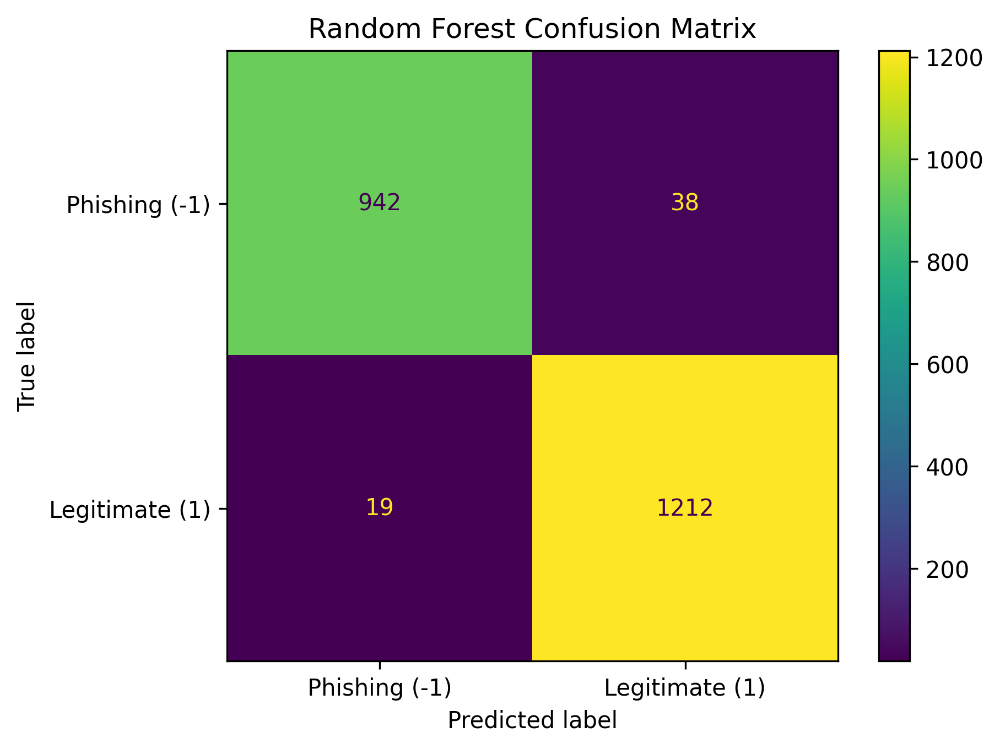
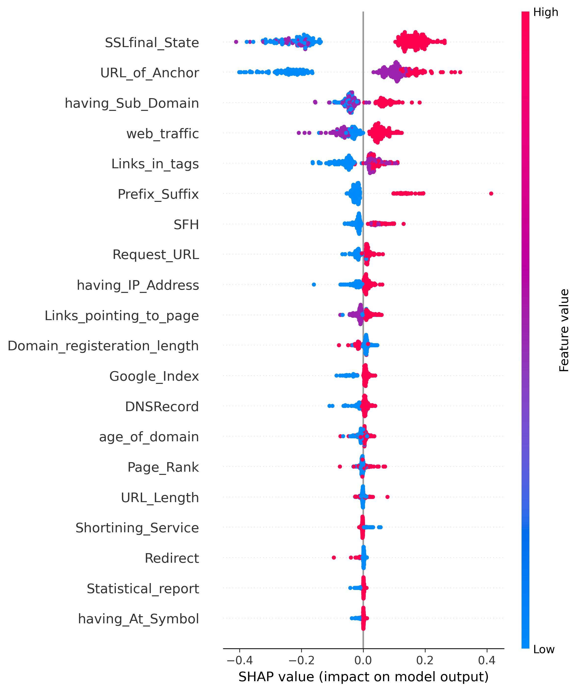

# Explainable Machine Learning for Phishing Website Detection

## Overview
This project compares Logistic Regression and Random Forest for detecting phishing websites, and uses SHAP to explain which features influence the Random Forest's predictions.

## Research question
How accurately can different machine learning models detect phishing websites, and which features influence their predictions?

## Dataset
- UCI Phishing Websites dataset, loaded through OpenML (data_id=4534)
- 11,055 websites, 30 features, no missing values
- Label: -1 = phishing (4,898 websites), 1 = legitimate (6,157 websites)
- All features are pre-computed and take the values -1, 0 or 1

## Method
- Stratified 80/20 train-test split (random_state=42): 8,844 training and 2,211 test websites
- Models: Logistic Regression (max_iter=1000) and Random Forest (100 trees, random_state=42)
- Explainability: Random Forest feature importance and SHAP, computed on a random sample of 300 test websites

 
## Results
All results are on one 2,211-website test split.

| Model | Accuracy | Phishing precision | Phishing recall |
|---|---|---|---|
| Logistic Regression | 0.929 | 0.94 | 0.90 |
| Random Forest | 0.974 | 0.98 | 0.96 |

Random Forest confusion matrix (test set): 942 phishing correctly detected, 38 phishing missed (predicted legitimate), 19 legitimate flagged as phishing, 1,212 legitimate correctly identified.

## Explainability
- Top Random Forest feature importances: SSLfinal_State (0.32) and URL_of_Anchor (0.25).
- In the SHAP summary plot, SSLfinal_State = 1 pushes predictions toward legitimate, and SSLfinal_State = -1 toward phishing.

## Error analysis
Among phishing websites in the test set, those with SSLfinal_State = 1 were missed more often (26 of 146) than those with SSLfinal_State = -1 (12 of 597). This suggests the model relies heavily on SSL status.

## Limitations
- Results come from a single train-test split, so differences between models may vary on other splits.
- The dataset contains pre-computed features, so this model cannot analyze an arbitrary URL without a matching feature-extraction system.
- Feature importance and SHAP show what the model relied on, not what causes phishing.
- SHAP was computed on a 300-website sample, not the full test set.
- The error analysis only examined SSLfinal_State.

## Files
- `Untitled0.ipynb`: notebook with all code and outputs
- `rf_confusion_matrix.png`, `shap_summary.png`: result figures

## Conclusion
On this test split, Random Forest (accuracy 0.974) performed better than Logistic Regression (accuracy 0.929). Random Forest relied most on SSLfinal_State and URL_of_Anchor, and it missed more phishing websites that had a good SSL status. Since all results come from a single split and pre-computed features, these findings are preliminary and would need cross-validation and a feature extractor to test on real URLs.
